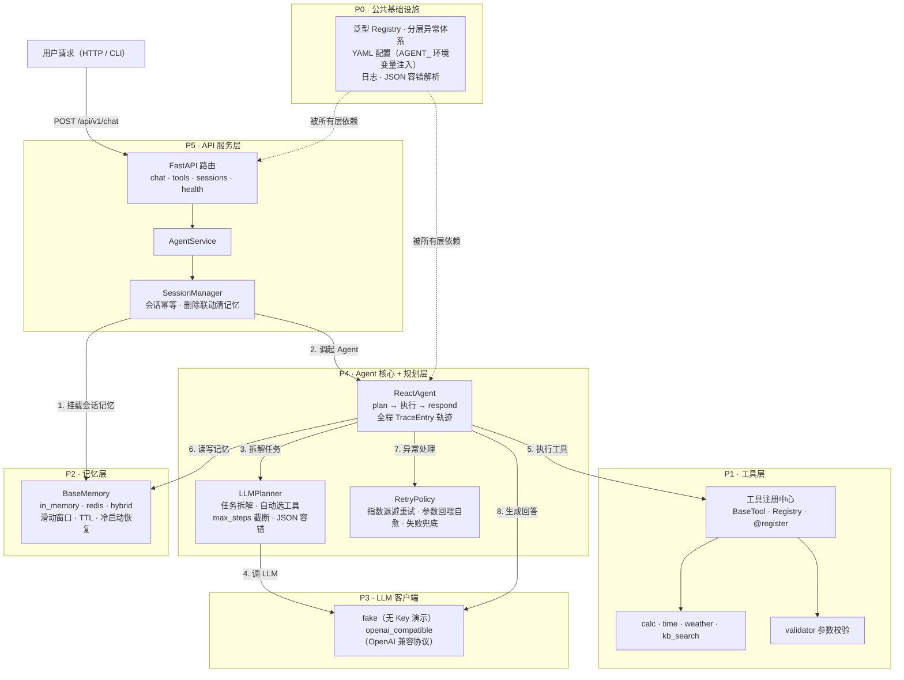
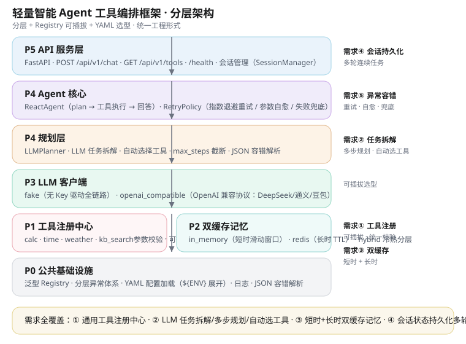

# 轻量智能 Agent 工具编排框架

> 自研轻量化 Agent 调度框架：统一工具注册、参数校验、任务规划、会话记忆。
> 市面 Agent 大多是一次性脚本——本项目把「工具、规划、记忆、容错」做成可插拔、可复用、可部署的分层框架。

[](https://www.python.org/)
[](https://github.com/DevinHeCoder/agent_framework/actions)
[](LICENSE)
[](docker-compose.yml)

## 核心能力

| # | 能力 | 落地形态 |
|---|------|----------|
| ① | 通用工具注册中心 | 泛型 `Registry` + `@register`，天气/检索/计算器/时间可插拔注册，统一参数校验 |
| ② | LLM 自动任务拆解 | `LLMPlanner`：多步骤规划、自动选择工具、max_steps 截断、JSON 容错解析 |
| ③ | 短时 + 长时双缓存记忆 | `in_memory`（滑动窗口）+ `redis`（TTL 持久化）+ `hybrid` 冷热分层、重启恢复 |
| ④ | 会话状态持久化 | `SessionManager` + memory 组合，多轮连续任务，API 级会话管理 |
| ⑤ | 异常重试 / 参数自愈 / 失败兜底 | `RetryPolicy`：指数退避重试、参数回喂 LLM 修正、兜底回答不崩流程 |

## 架构

### 分层架构总览



> 每层统一「抽象基类 + Registry + @register 实现」三件套，运行时用 YAML（或 `AGENT_` 环境变量）选型切换，新增能力 = 新增一个实现文件，零侵入。

### 详细架构图



## 目录结构

```
agent_framework/
├── config/               # settings.yaml（各层选型 + 环境变量注入）/ logging.yaml
├── src/
│   ├── common/           # Registry 泛型注册表、分层异常、常量
│   ├── utils/            # 配置加载（${ENV} 展开）、日志、JSON 容错解析
│   ├── tool/             # 工具注册中心 + validator + 4 个工具实现
│   ├── memory/           # 短时/长时/双缓存组合记忆
│   ├── llm_client/       # fake + openai_compatible
│   ├── planner/          # LLM 任务拆解
│   ├── agent/            # ReactAgent + RetryPolicy 容错策略
│   ├── session/          # 会话管理
│   └── api/              # FastAPI 应用工厂 / 路由 / service
├── tests/                # 205 个测试用例（pytest）
├── examples/             # CLI 多轮演示
├── docs/architecture.svg # 架构图
├── Dockerfile            # 多阶段构建 · 非 root · healthcheck
└── docker-compose.yml    # app + redis 一键编排
```

## 在线演示

无需安装、无需令牌即可在线体验完整功能（纯前端演示模式，不调用任何模型 API、不消耗任何额度）：

[**▶ 打开在线演示**](https://devinhecoder.github.io/agent_framework/) · GitHub Pages 托管

支持：多步任务拆解演示、天气 / 计算 / 时间 / 知识库检索、执行轨迹回放、双缓存记忆与会话管理展示。

## 快速开始

> 完整分步教程见 [docs/QUICKSTART.md](docs/QUICKSTART.md)（5 分钟跑通）。

```bash
# 1. 安装依赖
pip install -r requirements.txt

# 2. 运行全部测试
python -m pytest tests -q

# 3. CLI 多轮演示（fake LLM，无需任何 Key）
python examples/run_agent_demo.py
#    你> 帮我查一下杭州天气
#    你> 计算一下 3*8
#    你> 现在几点了

# 4. 启动 API 服务
uvicorn src.api.main:app --host 0.0.0.0 --port 8000
curl http://localhost:8000/health
curl -X POST http://localhost:8000/api/v1/chat \
     -H "Content-Type: application/json" \
     -d '{"query": "帮我算 (3+5)*2", "session_id": "demo-1"}'
```

### 使用真实 LLM

设置环境变量后即可切换真实大模型（OpenAI 兼容协议）：

```bash
export AGENT_LLM_PROVIDER=openai_compatible
export AGENT_LLM_BASE_URL=https://api.deepseek.com/v1   # DeepSeek 示例
export AGENT_LLM_API_KEY=sk-xxx
export AGENT_LLM_MODEL=deepseek-chat
python examples/run_agent_demo.py --provider openai_compatible
```

本地免费方案（Ollama）：`ollama pull qwen2.5:7b`，然后 `AGENT_LLM_BASE_URL=http://localhost:11434/v1`、`AGENT_LLM_MODEL=qwen2.5:7b`、`AGENT_LLM_API_KEY=ollama`。

**真实模型端到端验证**（交付信任证据，6 场景 + 多轮记忆，全部通过退出码 0）：

```bash
python examples/validate_real_llm.py
```

### 示例场景库（业务场景示例）

三个自包含业务场景，无 Key 一键运行，一行切换真实 LLM（详见 [examples/scenarios/README.md](examples/scenarios/README.md)）：

```bash
python examples/scenarios/scenario_qa_knowledge.py   # 知识库问答
python examples/scenarios/scenario_calc_chain.py     # 连续计算 + 容错
python examples/scenarios/scenario_multi_tool.py     # 多工具编排
```

### 性能基线

```bash
python examples/benchmark.py                                  # fake 基线（框架开销）
python examples/benchmark.py --provider openai_compatible     # 真实模型基线
# 报告写入 logs/benchmark_report.md
```

## API 端点

| 方法 | 路径 | 说明 |
|------|------|------|
| POST | `/api/v1/chat` | 多轮对话：`{"query": "...", "session_id": "..."}`，返回回答 + 执行轨迹 |
| GET | `/api/v1/tools` | 已注册工具 schema 列表 |
| GET | `/api/v1/sessions` | 会话列表（最近活跃倒序） |
| DELETE | `/api/v1/sessions/{id}` | 删除会话（联动清空记忆） |
| GET | `/health` | 健康检查 |
| GET | `/` | 服务信息 + 各层选型 |

## 配置（config/settings.yaml）

所有选型均为「可插拔开关」，支持环境变量注入（前缀 `AGENT_`，`${VAR:默认值}` 语法）：

| 配置段 | 关键字段 | 说明 |
|--------|----------|------|
| `tool` | `enabled: [calc, time, weather, kb_search]` | 启用工具白名单 |
| `tool` | `retry: 2` / `param_fix_attempts: 2` | 重试次数 / 参数自愈次数 |
| `memory` | `provider: in_memory / redis / hybrid` | 记忆选型（`AGENT_MEMORY_PROVIDER`） |
| `llm` | `provider: fake / openai_compatible` | LLM 选型（`AGENT_LLM_PROVIDER`） |
| `planner` | `provider: llm` · `max_steps: 6` | 规划器与最大步数 |
| `agent` | `provider: react` · `max_loop: 5` | Agent 与最大循环轮次 |
| `server` | `host / port` | 服务监听 |

## Docker 部署

```bash
docker compose up --build
# app: http://localhost:8000（默认 hybrid 双缓存记忆 + fake LLM）
# redis: localhost:6379
docker compose ps
```

## 文档

| 文档 | 内容 |
|------|------|
| [docs/QUICKSTART.md](docs/QUICKSTART.md) | 5 分钟快速开始（安装→测试→演示→真实 LLM→API） |
| [docs/ARCHITECTURE.md](docs/ARCHITECTURE.md) | 分层架构、请求链路、容错与记忆设计 |
| [docs/API.md](docs/API.md) | API 端点文档与 curl 示例 |
| [docs/CONFIGURATION.md](docs/CONFIGURATION.md) | 全部配置项与环境变量表 |
| [docs/DEPLOYMENT.md](docs/DEPLOYMENT.md) | Docker 一键部署（app + Redis） |
| [examples/scenarios/README.md](examples/scenarios/README.md) | 三个业务场景与扩展点 |

## 测试与验证

- **205 个 pytest 用例全绿**（覆盖注册中心、参数校验、四个工具、双缓存记忆、LLM 客户端、规划解析、Agent 容错链路、会话管理、API 端点）
- Redis 集成测试：本机有 Redis 服务时自动真实运行，否则自动跳过（无环境 CI 兼容）
- 演示链路（fake LLM）无需任何外部 Key 即可端到端跑通「拆解 → 调度 → 执行 → 记忆 → 多轮」

## 设计要点

- **分层 + Registry + @register**：每个能力层都是「抽象基类定义契约、Registry 管理实现、装饰器注册」，新增能力 = 新增一个实现文件，零侵入。
- **YAML 选型**：运行时切换实现只需改配置或环境变量，不碰代码。
- **异常语义即容错策略**：`ToolNotFound → 引导换工具`、`ToolParam → 回喂 LLM 自愈`、`ToolExecution → 重试/兜底`，错误类型本身就是 Agent 决策依据。
- **零外部依赖即可跑通**：validator 自研、fake LLM 驱动全链路；真实能力（OpenAI/Redis）按需启用。
